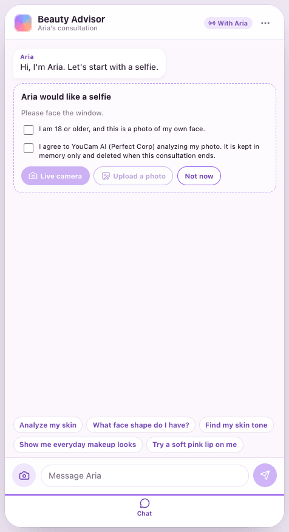
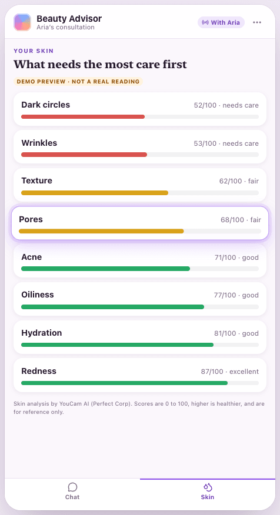
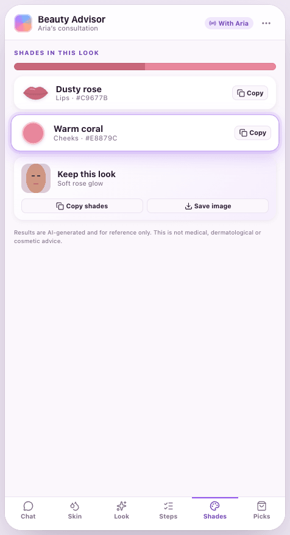

# YouCam Beauty Advisor

A beauty advisor that any AI agent can run. The client shares a selfie. The advisor measures their skin, reads their face shape and coloring, tries makeup on them, builds a look with steps and exact shades, and recommends products. [YouCam AI](https://yce.perfectcorp.com) does the analysis and the try-on.

This repository holds two things.

1. **The app**: a phone-sized web app the client uses, and the server behind it.
2. **The PPRO App API**: an open interface that gives an external agent the same view and the same controls the app has. The agent reads what the client says and shares, calls the app's tools, points the client at a screen or at one item on it, and speaks. A _ppro-app_ (Populi Professional app) is any app that implements it, so an advisor written once can run any of them.

<p align="center">
  
  
  
</p>

<p align="center"><sub>The app in simulated mode. Without a YouCam key, results are labeled <em>Demo preview</em>.</sub></p>

## Try it

Needs Node 22.12 or newer.

```sh
npm install
npm run dev
```

Open <http://localhost:5173> and press **Start a demo consultation**. You are the client. The panel beside the phone is the advisor's side: it holds your session's token and the commands that attach an agent.

To run the scripted advisor (no LLM needed), copy the command from the panel:

```sh
PPRO_URL=http://localhost:8787 PPRO_AGENT_TOKEN=<token from the panel> npm run agent:demo
```

It greets you and asks for a selfie. When you share one it analyzes your skin, face and colors, tries a look on you and walks you through it. Nothing is billed: without a `YOUCAM_API_KEY` the app runs in simulated mode.

## Connect your own agent

| You have                                  | Do this                                                                                                                                                                                                                                                            |
| ----------------------------------------- | ------------------------------------------------------------------------------------------------------------------------------------------------------------------------------------------------------------------------------------------------------------------ |
| An MCP client (Claude Code, Cursor, etc.) | `claude mcp add --transport http beauty-advisor http://localhost:8787/mcp --header "Authorization: Bearer <advisor token>"`                                                                                                                                        |
| An LLM with tool calling                  | Fetch the system prompt from `GET /ppro/v1/sessions/current/instructions` and the tools from `GET …/tools?format=openai`, `gemini` or `anthropic`, then loop. [`examples/llm-agent.ts`](examples/llm-agent.ts) is that loop in about 100 lines.                    |
| A script, in any language                 | Plain HTTP with a Bearer token: long-poll or stream (SSE) the events, call tools, post messages. The TypeScript SDK in [`src/client`](src/client/index.ts) wraps it, and [`examples/scripted-agent.ts`](examples/scripted-agent.ts) is a complete working advisor. |

```ts
import { AdvisorClient } from "./src/client/index.ts";

const advisor = new AdvisorClient({ baseUrl: "http://localhost:8787", token });

for await (const event of advisor.events()) {
  if (event.type === "photo.added") {
    await advisor.tool("analyze_skin"); // a refusal comes back as { ok: false, error }
    await advisor.tool("ui_show", { target: "skin:pore" }); // move the client's screen
    await advisor.say("Your pores are the place to start.");
  }
}
```

The [agent guide](docs/AGENT-GUIDE.md) has the whole loop and the things that trip people up.

## What an agent can do

18 tools, listed with their JSON Schemas in the app's [manifest](spec/manifest.example.json).

| Group           | Tools                                                                                                                        |
| --------------- | ---------------------------------------------------------------------------------------------------------------------------- |
| Analyze, try on | `analyze_skin`, `analyze_face`, `analyze_skin_tone`, `list_makeup_looks`, `try_on_look`, `try_on_makeup`, `try_on_full_look` |
| Present         | `present_look`, `recommend_products`                                                                                         |
| Control the app | `ui_show`, `ui_compare`, `ui_request_photo`, `ui_notice`                                                                     |
| Run the session | `say`, `set_presence`, `get_session_state`, `wait_for_events`, `end_session`                                                 |

The client's app has seven screens: Chat, Skin, Face, Look, Steps, Shades and Picks. Everything on them has a name the agent can point at, such as `skin:pore`, `shade:1` or `step:2`. The agent can also take the client along or let them roam (`following`).

## Real YouCam results

```sh
cp .env.example .env     # then set YOUCAM_API_KEY
npm run dev
```

You need your own YouCam API key and you pay YouCam for what it analyzes. Each session has a budget (`YOUCAM_UNITS_PER_SESSION`, 100 by default) and the server has a daily task cap (`YOUCAM_DAILY_TASK_CAP`, 300), so an agent cannot overspend.

## Offer it from your own product

A _host_ is the product that has the client: it creates the session, shows the client's side in the browser and gives the advisor's side to the agent.

```ts
import { HostClient } from "./src/client/index.ts";

const host = new HostClient({ baseUrl, hostKey: process.env.PPRO_HOST_KEY! });
const created = await host.createSession({
  advisor: { name: "Mara", persona: "Warm, a little witty. Short sentences." },
  client: { display_name: "Ada" },
  minutes: 30,
});
// created.urls.client   -> the client's browser or an iframe (the token is in the URL fragment)
// created.tokens.agent  -> your advisor's runtime; never send this to a browser
```

The [host guide](docs/HOST-GUIDE.md) covers deployment, embedding in an iframe, relaying the client's voice and a go-live checklist.

## Documentation

| Read                                         | For                                                                                       |
| -------------------------------------------- | ----------------------------------------------------------------------------------------- |
| [docs/PPRO-APP-API.md](docs/PPRO-APP-API.md) | The standard: roles, sessions, events, tools, screens, errors, safety rules, conformance. |
| [docs/AGENT-GUIDE.md](docs/AGENT-GUIDE.md)   | Building the advisor: the loop, LLMs, MCP, what to watch for.                             |
| [docs/HOST-GUIDE.md](docs/HOST-GUIDE.md)     | Running the app and embedding it in your product.                                         |
| [docs/ARCHITECTURE.md](docs/ARCHITECTURE.md) | How the code is laid out, what a host keeps to itself, and where the seams are.           |
| [spec/](spec/README.md)                      | OpenAPI 3.1 and JSON Schemas, generated from the code and checked in CI.                  |
| [SECURITY.md](SECURITY.md)                   | How to report a vulnerability, and the model the code defends.                            |
| [CONTRIBUTING.md](CONTRIBUTING.md)           | Setup, checks and how to change the API.                                                  |

## Develop

| Command                          | What it does                                                            |
| -------------------------------- | ----------------------------------------------------------------------- |
| `npm run dev`                    | API on :8787 and the web app on :5173, both reloading.                  |
| `npm run build` then `npm start` | The production build, served by one Node process.                       |
| `npm run check`                  | Typecheck, lint, format check, tests and the spec drift check.          |
| `npm run test:e2e`               | Browser tests (Playwright). Run `npx playwright install chromium` once. |
| `npm run spec:build`             | Regenerate `spec/` after changing a route, tool or event.               |
| `npm run agent:demo`             | The scripted advisor, against `PPRO_URL` with `PPRO_AGENT_TOKEN`.       |

## Limits worth knowing

- **Live YouCam calls are tested against a fake of its documented API, not against the live service.** Try it with your key and a real selfie before you rely on it.
- **The face must fill most of the photo** (over 60% of its width). There is no server-side cropping, so YouCam refuses small faces and the client is told how to retake the photo.
- **Sessions live in one process's memory.** Run one instance, or route each session to the instance that created it. Restarting ends every session. Photos are never written to disk.
- **The Dockerfile** is built and smoke-tested by CI on every push.

## Privacy in short

The client must confirm they are 18 or older and agree to YouCam analyzing their photo before any photo tool runs, and the agent cannot give either consent for them. Photos and everything made from them stay in memory and are deleted when the session ends or the client deletes them. Age, gender and ethnicity are removed from results. The agent cannot see image bytes unless the host turns that on for the session. See [section 9 of the standard](docs/PPRO-APP-API.md#9-photos-consent-and-privacy).

## License

[MIT](LICENSE).

This project is not affiliated with or endorsed by Perfect Corp. YouCam is a trademark of Perfect Corp. You bring your own API key and are bound by its terms.
